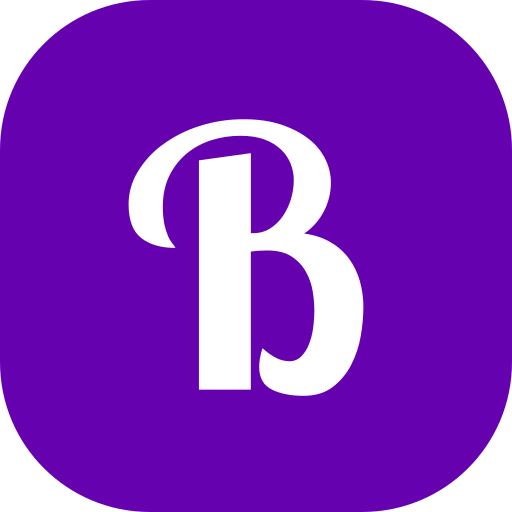
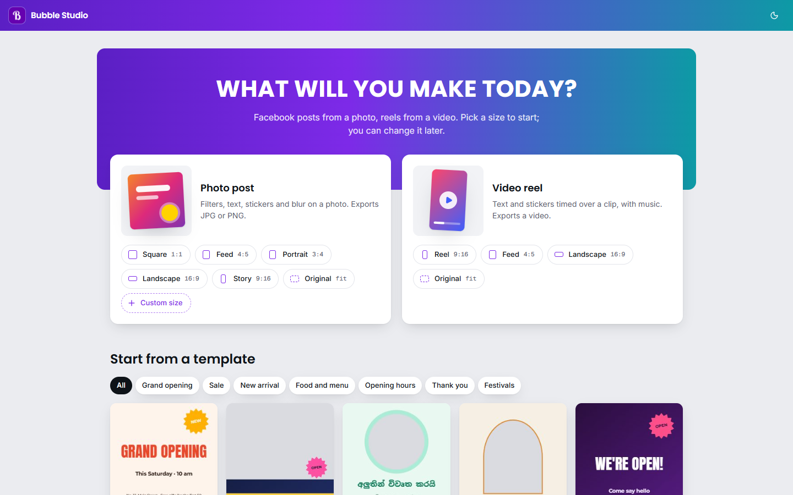
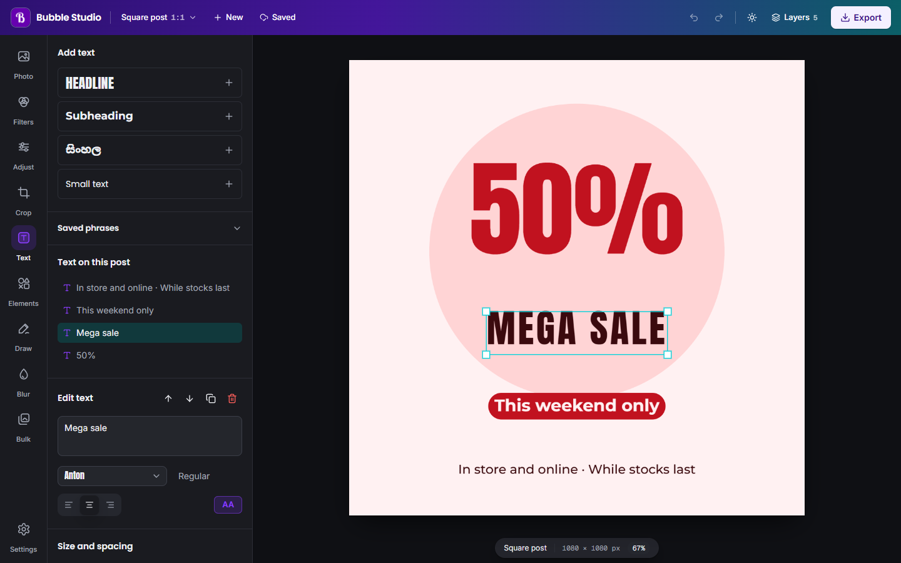
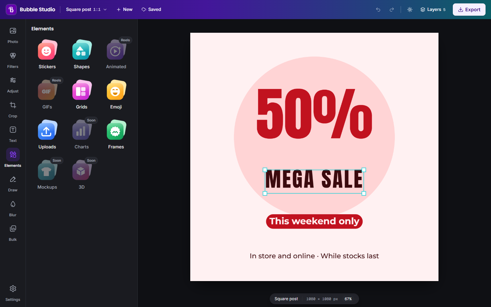

<div align="center">



# Bubble Studio

**Make Facebook posts and reels that look professional, in minutes, on your own computer.**

A Canva-style editor for small businesses, in English and සිංහල. Everything runs on your device:
your photos, videos and designs are never uploaded.

[](https://github.com/harindujayakody/bubble-studio/releases/latest)
[](https://github.com/harindujayakody/bubble-studio/releases)
[](LICENSE)


[Download](#download) · [Features](#features) · [Architecture](docs/ARCHITECTURE.md) · [Roadmap](docs/ROADMAP.md) · [Changelog](CHANGELOG.md)



</div>

## Download

| Platform | Get it | Notes |
|---|---|---|
| **Windows 10 / 11** | [Bubble-Studio-Setup.exe](https://github.com/harindujayakody/bubble-studio/releases/latest) | Updates itself in the background |
| **macOS** (Apple Silicon: M1, M2, M3) | [Bubble-Studio-arm64.dmg](https://github.com/harindujayakody/bubble-studio/releases/latest) | First launch: right-click the app → **Open** |
| **Web** | Run it locally (see [Develop](#develop)) | Same features and the same version number |

The installers aren't code-signed yet, so Windows may show *"Windows protected your PC"*: choose
**More info → Run anyway**. Signing is on the [roadmap](docs/ROADMAP.md).

## Features

<table>
<tr>
<td width="50%" valign="top">

### Design
- **69 templates** in 1:1, 4:5 and 9:16 for openings, sales, new arrivals, food, opening hours, events, quotes, social posts and festivals (Sinhala & Tamil New Year, Vesak, Christmas, Eid, Deepavali)
- **Brand kit:** your logos, colours and fonts, offered first everywhere
- **Write with AI:** post text and captions in English, Sinhala or Tamil, with your own OpenRouter key (optional)
- **Text** in 40 fonts (English and Sinhala) with outline, fills and **effects**: curve, glow, neon, hollow, gradient, echo
- **Elements:** stickers, 31 shapes, photo frames, emoji, uploads, collages (grids), **charts, tables and QR codes**
- **Draw** with pen, marker and highlighter
- **Magic resize** to 1:1, 4:5, 3:4, 9:16 and 16:9 at once

</td>
<td width="50%" valign="top">

### Photos
- **35+ filters** (classic, Instagram-, TikTok- and Snapchat-inspired) and adjustments
- **Background remover** that runs offline in the desktop app
- Crop, rotate, reposition, blur or pixelate areas
- **Watermark** ("Shot on…", badge, logo or your signature) on every export
- Export **JPG or PNG** at the exact size

</td>
</tr>
<tr>
<td valign="top">

### Reels
- Timeline for when text and stickers appear
- **Text animations** (fade, pop, slide, typewriter, wobble, bounce, pulse)
- Animated stickers and GIFs
- Background music with volume, fade and auto-fit to the clip
- **Fast MP4 export**, frame by frame with WebCodecs
- **Photo slideshows**, **merge videos** (with transitions) and **extract audio** (MP3, M4A, WAV)
- **Cut and speed**, and **captions** (typed, pasted or .srt)

</td>
<td valign="top">

### Work faster
- **Bulk edit** photos or reels: one design on many files, or each edited separately, with random looks, text per item and random music
- **Continue designing:** your last 5 designs are kept on this computer
- Light and dark mode, instant switch
- Export folder sorted into Reels, Photos, Audios and Merged Videos
- Undo/redo, layers with drag to reorder
- **Select several layers**: align, space evenly, group and lock, with **smart guides**
- **Save as file** (`.bubble`) to back up a design or move it to another computer

</td>
</tr>
</table>

<p align="center">
  
  
</p>

## Privacy

- **No account and no server.** Editing, rendering, background removal and exporting all happen on your device.
- Your designs are stored only in this browser or app (IndexedDB), and only the 5 most recent.
- The desktop app connects to the internet to check GitHub Releases for updates and, only if you add an
  OpenRouter key, to send your AI writer prompt and the design's words to OpenRouter. The key stays on your computer
  (encrypted in the desktop app).

## Develop

Requirements: **Node.js 22+** and npm.

```bash
git clone https://github.com/harindujayakody/bubble-studio.git
cd bubble-studio
npm install
npm run dev        # http://localhost:3000
```

| Command | What it does |
|---|---|
| `npm run dev` | Start the web app with hot reload |
| `npm run build` | Production web build |
| `npm run lint` | ESLint |
| `npm run test:e2e` | End-to-end tests in Chromium (starts the dev server) |
| `npm run desktop:dev` | Build the static app and open it in Electron |
| `npm run desktop:dist` | Build the Windows installer into `dist-desktop/` |
| `npm run desktop:dist:mac` | Build the macOS dmg and zip (run on a Mac) |
| `npm run changelog` | Regenerate `CHANGELOG.md` from `changelog.json` |

**Add your own content:** put PNG stickers in `public/custom_icons` and MP3s in `public/music`.
They appear in the editor automatically.

## How it's built

| Layer | Technology |
|---|---|
| App | Next.js 16 (App Router), React 19, TypeScript |
| UI | Tailwind CSS v4, shadcn/ui on Base UI, Lucide icons, custom duotone tool icons |
| Rendering | Canvas 2D: one `renderPost()` for the preview and every export |
| Video and audio | WebCodecs via [Mediabunny](https://mediabunny.dev), Web Audio, MediaRecorder fallback |
| On-device ML | ONNX Runtime Web + U²-Netp (Apache-2.0) |
| Desktop | Electron 44, electron-builder, electron-updater |
| Release | GitHub Actions: Windows + macOS builds, published to GitHub Releases |

Read **[ARCHITECTURE.md](docs/ARCHITECTURE.md)** for diagrams of the document model, rendering,
exports, the desktop shell and the release pipeline.

## Versioning and releases

The web app and the desktop app always share **one version number**: the `VERSION` file holds the
major and minor number (`1.3`), and the patch is the number of commits since it changed (`1.3.0`,
`1.3.1`…).

Every push to `main` runs `.github/workflows/desktop-release.yml`:

1. **Version:** the version is computed from `VERSION` and the commit count.
2. **Check:** types, lint and the end-to-end tests must pass, or nothing is built.
3. **Build:** the Windows installer and the macOS dmg/zip are built in parallel.
4. **Release:** both are published to [Releases](https://github.com/harindujayakody/bubble-studio/releases), with notes taken from [`changelog.json`](changelog.json).

Installed apps check for updates at start and every four hours, install in the background, and
offer **Restart now**. The workflow needs no secrets; the repo must stay public for apps to read releases.

To log a change, add it to the top entry of `changelog.json` and run `npm run changelog`.

## Project docs

| Doc | What's in it |
|---|---|
| [ARCHITECTURE.md](docs/ARCHITECTURE.md) | How the app is put together, with diagrams |
| [ROADMAP.md](docs/ROADMAP.md) | What's next, how each feature is built, and the outcome |
| [CHANGELOG.md](CHANGELOG.md) | Every release, shared by web and desktop |
| [DESIGN.md](DESIGN.md) | The design system: colours, type, components |
| [PRODUCT.md](PRODUCT.md) | Who it's for and the product principles |

## Contributing

Issues and pull requests are welcome. Please:

- keep everything **on-device** (no new servers or accounts) and **MIT-compatible** (no AGPL code, no non-commercial models or fonts);
- check the preview matches the export, in light and dark;
- run `npm run lint`, `npx tsc --noEmit` and `npm run test:e2e` before opening a PR;
- add a line to `changelog.json`.

## Credits

Made by **Harindu Jayakody**. A product of [Infiax.com](https://infiax.com).

Fonts are from Google Fonts via [Fontsource](https://fontsource.org) (SIL Open Font License).
Background removal uses [U²-Net](https://github.com/xuebinqin/U-2-Net) (Apache-2.0) on
[ONNX Runtime](https://onnxruntime.ai) (MIT). Template sample photos are from [Unsplash](https://unsplash.com)
(Unsplash License); photographers are listed in [`public/samples/CREDITS.md`](public/samples/CREDITS.md).

## License

[MIT](LICENSE) © Harindu Jayakody
