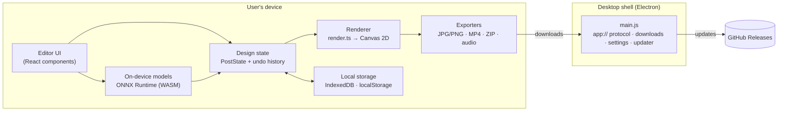
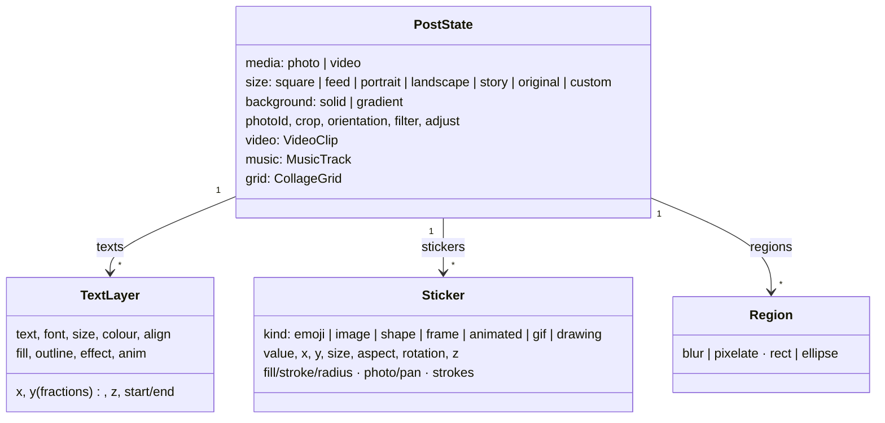
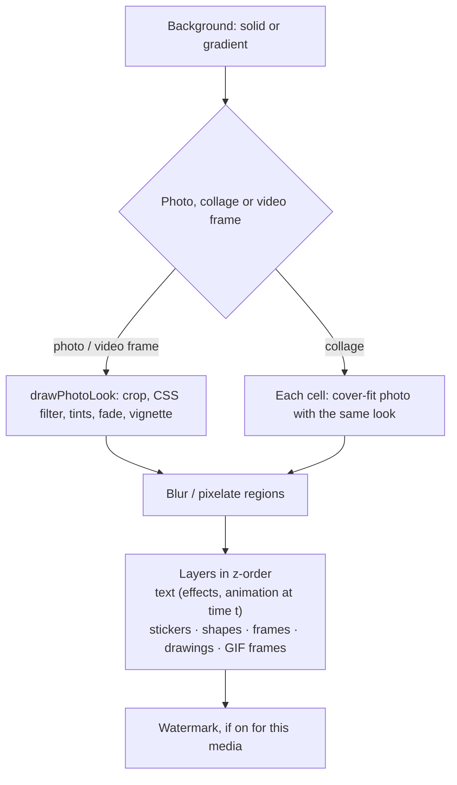
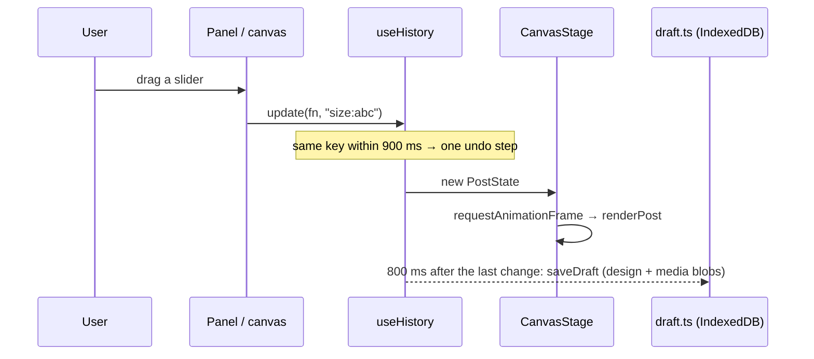
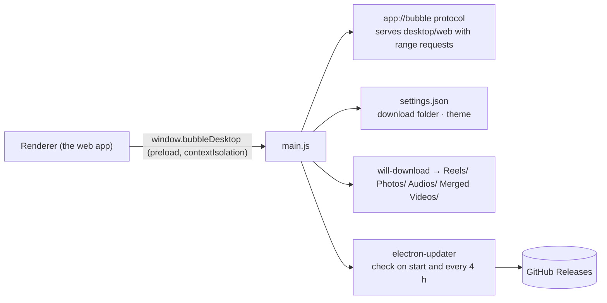
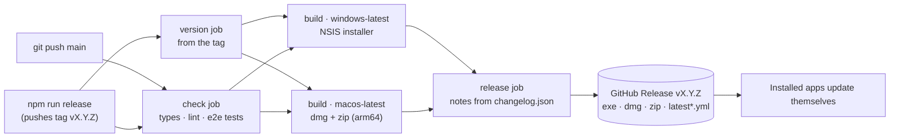

# Architecture

Bubble Studio is a **client-only** design editor. All editing, rendering and exporting happens on the
user's device. There is no backend and no account. The same Next.js app runs in a browser and inside
an Electron shell, which adds offline files, a save folder and automatic updates.



## Runtimes

| | Web | Desktop (Windows, macOS) |
|---|---|---|
| App | Next.js 16 (App Router) served normally | The same app as a static export (`BUILD_TARGET=desktop`), served from `app://bubble` |
| Shell | Browser | Electron 44 (`desktop/main.js`, `desktop/preload.js`) |
| Files | Downloads, or a picked folder (File System Access API) | Master export folder with `Reels/ Photos/ Audios/ Merged Videos/` |
| Updates | Deploy | `electron-updater` from GitHub Releases, silent install on Windows |
| Version | `VERSION` + commits since it changed (`scripts/app-version.mjs`) | Same number, from the release tag |

The two never differ in features except where a capability needs the shell (the save folder,
updates) or, per [#27](https://github.com/harindujayakody/bubble-studio/issues/27), heavy models.

## Source map

```
src/
  app/                    Next.js entry: layout (fonts, theme script, toaster), page (reads libraries), globals.css (tokens)
  components/
    ui/                   shadcn/ui on Base UI: button, dialog, popover, select, slider, switch, toggle…
    editor/
      editor.tsx          The editor shell: state, history, tools, top bar, file inputs, autosave, export buttons
      canvas-stage.tsx    The canvas: fits the post, draws it, layer handles, crop/pan/blur/draw interactions
      start-screen.tsx    Start page: create cards, templates, recent designs, tools, footer
      panels.tsx          Photo, Filters, Adjust, Crop, Text panels
      panels-extra.tsx    Elements browser, sticker/shape/frame editor, Blur
      bulk-panel.tsx      Bulk photos and reels, separate edits, variations
      reel.tsx, music-panel.tsx   Video, timeline and music
      …                   draw, brand kit, watermark, magic resize, media tools, settings, templates gallery
  lib/
    theme.ts              Light/dark without a provider (class on <html>, pre-paint script)
    editor/
      types.ts            PostState and every layer type: the document model
      render.ts           renderPost(): the one renderer for canvas, thumbnails and every export
      filters.ts          Filter presets → CSS filter string + tint/fade/vignette passes
      stickers.ts, elements.ts, draw.ts, gif.ts   Drawing of stickers, shapes, animated stickers, drawings, GIFs
      watermark.ts, brand.ts                       Saved preferences (localStorage) used at render time
      use-history.ts      Undo/redo with key-coalescing (a slider drag is one step)
      draft.ts            Recent designs in IndexedDB (design JSON + its media)
      save.ts             saveExport(): one exit for every file, sorted into kinds
      fast-export.ts      Reel export frame-by-frame with WebCodecs (Mediabunny)
      video.ts            Real-time reel recording fallback (MediaRecorder + Web Audio)
      media-tools.ts      Merge videos, extract audio
      templates.ts, resize.ts, bg-remove.ts        Templates, magic resize, background removal
desktop/                  Electron main + preload; desktop/web is the static build (generated)
scripts/                  desktop-build.mjs, copy-ort.mjs (ONNX runtime files), changelog.mjs
public/                   custom_icons/ (sticker library), music/, models/u2netp.onnx, favicon
.github/workflows/        desktop-release.yml: check on every push; version → build → release for tags
```

## The document model

A design is one serialisable object, `PostState` (`src/lib/editor/types.ts`):



Rules that keep it simple:

- **Positions are fractions** of the post (0…1), sizes are pixels at the post's design width, so
  the same design renders at any output size, and Magic resize is arithmetic.
- **Media stays out of the state.** Layers reference images, videos and audio by id; the elements
  live in maps beside the state (and in IndexedDB for drafts). History stays small and fast.
- **Layers share one z-order**, so text and stickers interleave freely.
- **Preferences are not part of a design**: the watermark, brand kit, theme and export folder are
  saved once and apply everywhere.

## Rendering: one function for everything

`renderPost(ctx, { source, assets, state, width, time })` draws a complete post onto any canvas.
The editor preview, filter thumbnails, template previews, bulk previews, JPG/PNG export and every
reel frame all call it, so **what you see is what you export**.



Time-based things (reel text animations, animated stickers, GIFs, layer timing) take `time`
as input. For photos `time` is undefined and they render in their resting pose.

## State, history and saving



- Undo/redo keeps 100 steps.
- Recent designs: the newest 5 are kept with their media; older ones and unused files are pruned.

## Exporting

| Output | Path | How |
|---|---|---|
| Photo | `exportPost` → JPG/PNG | `renderPost` at export size → `canvas.toBlob` |
| Reel (fast) | `fastExportReel` | Mediabunny decodes each source frame (WebCodecs), `renderPost` per frame, H.264 + AAC encode, audio mixed offline |
| Reel (fallback) | `exportReel` | Real-time `MediaRecorder` on the canvas with a Web Audio mix |
| Bulk / Magic resize | ZIP | Each design rendered and stored with `fflate` |
| Merge videos, Extract audio | `media-tools.ts` | Mediabunny conversion and encoding |

Every file leaves through `saveExport(blob, name, kind)`. On desktop the shell routes it into the
master folder's subfolder. On the web it goes to a picked folder (Chromium) or a normal download.

## Desktop shell



- The renderer is sandboxed (`contextIsolation`, no Node); `preload.js` exposes a small, typed
  bridge (`DesktopBridge` in `desktop-updates.tsx`).
- Links to the web open in the user's browser; the window never navigates away from the app.
- `BUBBLE_STUDIO_USER_DATA` points the app at a separate data folder (used for testing).

## On-device machine learning

Background removal runs **U²-Netp** (Apache-2.0) on **ONNX Runtime Web** (MIT) in WebAssembly.
The model ships in `public/models`; the runtime files are copied from `node_modules` into
`public/ort` on install (`scripts/copy-ort.mjs`). Nothing is uploaded. Licences are checked for
MIT compatibility (no AGPL or non-commercial models).

## Release pipeline



- Pushes to `main` only run the checks; installers are built and published for a release tag
  (`npm run release`) or a manual run.
- One version for web and desktop: `VERSION` holds major.minor; the patch is the number of commits
  since `VERSION` changed, worked out in one place (`scripts/app-version.mjs`) for the web build,
  the release command and the workflow.
- Release notes come from `changelog.json` (see [CHANGELOG.md](../CHANGELOG.md)).
- No secrets: the workflow uses GitHub's built-in token.

## Design system

Tokens live in `src/app/globals.css` (light `:root`, dark `.dark`) and are documented in
[DESIGN.md](../DESIGN.md). Theme switching swaps CSS variables only. A pre-paint script applies the
saved theme so there is no flash, and the desktop window frame follows it.

## Principles

1. **Local first.** No server, no account. Network use is limited to opt-in features (the planned
   AI writer) and update checks.
2. **One renderer.** Every preview and export goes through `renderPost`.
3. **Small dependencies.** Platform APIs first (Canvas, WebCodecs, File System Access), then a
   library only when it earns its place (Mediabunny, fflate, ONNX Runtime).
4. **Same app, two shells.** The desktop app adds capabilities; it never forks the editor.
