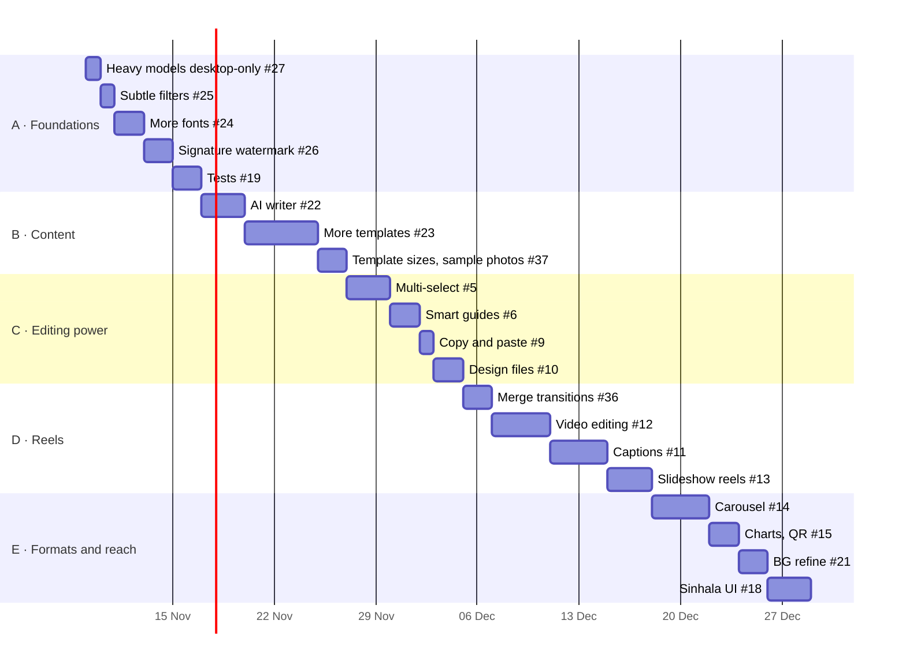

# Roadmap

Where Bubble Studio is going, how each step is built, and what it delivers. Progress is tracked in
GitHub issues; the tracking issue for this roadmap is
[#28](https://github.com/harindujayakody/bubble-studio/issues/28).

**Goal:** a small-business owner in Sri Lanka can make a professional Facebook post or reel, in
English or Sinhala, in a couple of minutes, on their own computer, without a design background.

## How we work

- **One feature, one release.** Every feature lands in its own commit that closes its issue; the push
  builds the Windows and Mac installers and the web app at the same version.
- **Definition of done:** works in light and dark, at desktop and phone widths; the preview matches
  the JPG/PNG/MP4 export; bulk edit and saved designs carry it; no console errors; tested in the
  browser; [CHANGELOG](../CHANGELOG.md) updated.
- **Local first:** nothing leaves the device unless the user switches a feature on (the AI writer).
- **Licences:** everything bundled must be MIT-compatible (no AGPL code, no non-commercial models or fonts).

## Done: Roadmap 1 (v1.3)

| Feature | Issue |
|---|---|
| Text effects: curve, glow, neon, hollow, gradient, echo | [#8](https://github.com/harindujayakody/bubble-studio/issues/8) |
| Photo frames and shape masks | [#7](https://github.com/harindujayakody/bubble-studio/issues/7) |
| Draw tool | [#16](https://github.com/harindujayakody/bubble-studio/issues/16) |
| Brand kit | [#2](https://github.com/harindujayakody/bubble-studio/issues/2) |
| Templates library (31) | [#1](https://github.com/harindujayakody/bubble-studio/issues/1) |
| Magic resize | [#4](https://github.com/harindujayakody/bubble-studio/issues/4) |
| Background remover (on device) | [#3](https://github.com/harindujayakody/bubble-studio/issues/3) |

## Roadmap 2 at a glance

About **7–8 weeks** of focused work. Code signing ([#17](https://github.com/harindujayakody/bubble-studio/issues/17)) runs in parallel because it waits on an outside approval.

---

## Phase A · Foundations and quick wins (~1 week)

Small, low-risk features first, and tests, so the bigger work doesn't break what exists.

### A1 · Heavy models in the desktop app only · [#27](https://github.com/harindujayakody/bubble-studio/issues/27) · ½ day
- **How:** one `heavyModels` check (`!!window.bubbleDesktop`); in the web build, "Remove background"
  shows a *Desktop app* badge and a download link; `/models` and `/ort` are copied only into the
  desktop export.
- **Outcome:** the web app stays light (no 15 MB+ runtime download); the desktop app keeps working offline.
- **Risk:** none notable.

### A2 · Subtle, natural filters · [#25](https://github.com/harindujayakody/bubble-studio/issues/25) · 1 day
- **How:** 15+ presets in `filters.ts` with saturation capped at +12% and small contrast changes;
  a new *Natural* group shown first; extra *Food*, *Product*, *Portrait* groups.
- **Outcome:** owners can improve a photo without it looking edited; tested on portrait, food,
  product and landscape photos.

### A3 · More fonts · [#24](https://github.com/harindujayakody/bubble-studio/issues/24) · 1–2 days
- **How:** add 20+ OFL fonts via Fontsource (only the weights used), including every remaining
  Sinhala font; regroup the font picker (*Headline, Script, Clean, Serif, Sinhala*) with search.
- **Outcome:** a wider typographic range, all offline; needed by the signature and new templates.
- **Risk:** installer size. Keep weights minimal and record the size in the release notes.

### A4 · Signature watermark · [#26](https://github.com/harindujayakody/bubble-studio/issues/26) · 1–2 days
- **How:** a *Signature* watermark style: typed (script fonts from A3) or drawn on a small pad that
  reuses the draw tool's smoothing; saved as a transparent PNG with the watermark settings.
- **Outcome:** photographers and artists can sign every export automatically.

### A5 · Render and export tests · [#19](https://github.com/harindujayakody/bubble-studio/issues/19) · 2 days
- **How:** headless Chrome renders a set of fixture designs through `renderPost` and compares
  snapshots (filters, text effects, frames, shapes, watermark), plus one photo and one short reel
  export; the release workflow runs them before publishing.
- **Outcome:** regressions (like a theme change darkening the header) are caught before release.

## Phase B · Content (~1.5 weeks)

### B1 · AI writer with OpenRouter · [#22](https://github.com/harindujayakody/bubble-studio/issues/22) · 3 days
- **How:**
  1. *Settings → AI*: paste an OpenRouter key, pick a model, *Test key*. Stored only locally:
     encrypted with Electron `safeStorage` on desktop, localStorage on the web (with a clear note).
  2. *Text → Write with AI*: prompt, language (English, Sinhala, Tamil, mixed), tone/accent, word
     limit and target (headline, whole design, caption with hashtags).
  3. The model returns JSON (`headline, subheading, body, caption, hashtags`); the app validates it,
     enforces the word limits and maps each field to text layers by role, keeping their styling.
  4. Desktop sends the request from the main process so the key never reaches the page.
- **Outcome:** three ready-to-use suggestions in seconds; one click fills the design or copies a caption.
- **Privacy:** off by default; only the prompt and the design's current words are sent, straight to OpenRouter.

### B2 · More templates (30+) · [#23](https://github.com/harindujayakody/bubble-studio/issues/23) · 4–5 days
- **How:** new layouts in the styles of the owner's reference images (kept locally, never
  published): social-post mockup, motivational photo poster, illustrated holiday cards, event
  announcements, and 9:16 stories. Built only from our own shapes, frames, fonts, effects and
  stickers; new pieces where needed (a post-card frame, a dark gradient overlay).
- **Outcome:** 60+ templates in total, in 1:1, 4:5 and 9:16, English and Sinhala, all restyled by the brand kit.

### B3 · One size per gallery view, sample photos · [#37](https://github.com/harindujayakody/bubble-studio/issues/37) · 2 days
- **How:** a size switch (1:1 · 4:5 · 9:16) above the gallery; every template is built at the chosen
  size (the layouts already scale to the height), so all tiles share one shape. Photo slots show
  bundled Unsplash sample photos (about 20, ~3 MB, credited, never fetched at run time) that one
  click replaces.
- **Outcome:** a calm, even gallery where every template looks finished, in every size.

## Phase C · Editing power (~1.5 weeks)

### C1 · Multi-select, group, lock, align · [#5](https://github.com/harindujayakody/bubble-studio/issues/5) · 3 days
- **How:** selection becomes a set; Shift-click and a drag rectangle add to it; a group is a layer
  with children (rendered recursively); `locked` blocks moving; align/distribute act on the
  selection's boxes.
- **Outcome:** layouts with many elements can be built and adjusted quickly, like in Canva.
- **Risk:** touches the canvas interaction code. Comes first in the phase, with tests from A5.

### C2 · Smart guides · [#6](https://github.com/harindujayakody/bubble-studio/issues/6) · 2 days
- **How:** while dragging, compare the moving box's edges and centre with other layers and the
  margins; snap within 6 px; draw pink guide lines and spacing labels.
- **Outcome:** neat, aligned layouts without manual nudging.

### C3 · Copy and paste layers · [#9](https://github.com/harindujayakody/bubble-studio/issues/9) · 1 day
- **How:** Ctrl+C / Ctrl+V with an in-app clipboard (layers + referenced media); paste offsets
  slightly; works across designs and in bulk separate-edit mode.
- **Outcome:** reuse a headline style or a logo block across posts.

### C4 · Save and open design files · [#10](https://github.com/harindujayakody/bubble-studio/issues/10) · 2 days
- **How:** `.bubble` file = ZIP (`fflate`) of the design JSON + its media; *Save design* / *Open
  design*; the desktop app associates the file type.
- **Outcome:** designs can be backed up, shared and moved between computers, beyond the 5 recent ones.

## Phase D · Reels (~2 weeks)

### D1 · Merge transitions and file names · [#36](https://github.com/harindujayakody/bubble-studio/issues/36) · 2 days
- **How:** a transition picker on Merge videos: Cut (default, a clean professional cut), crossfade,
  fade through black or white, slide and zoom, with a duration. Clips overlap and blend while
  `mergeVideos` draws them; the sound crossfades with the picture. The result is named
  `{first file}_merge.mp4` and never overwrites an existing file.
- **Outcome:** merged videos that flow like an edited reel, with names you can find later. The
  blending code is reused by D2 and D4.

### D2 · Video editing: split, speed, transitions · [#12](https://github.com/harindujayakody/bubble-studio/issues/12) · 4 days
- **How:** a clip becomes a list of segments (source in/out, speed); the timeline gains *Split* and
  delete; Merge videos gets fade/slide/zoom transitions; fast export maps output time to segment time.
- **Outcome:** trim out the bad parts, speed up or slow down, smooth joins, in the same fast export.

### D3 · Captions · [#11](https://github.com/harindujayakody/bubble-studio/issues/11) · 4 days
- **How:** caption track (text + start/end) on the timeline with styles (box, outline, highlighted
  word). Automatic captions in the **desktop app only** with on-device speech-to-text (Whisper via
  ONNX/WASM, per #27); typing works everywhere.
- **Outcome:** reels that make sense with the sound off.

### D4 · Photo slideshow reels · [#13](https://github.com/harindujayakody/bubble-studio/issues/13) · 2–3 days
- **How:** pick photos → each becomes a timed segment with Ken Burns zoom and the D1 transitions (#36);
  music fitted to the length; exported with the existing fast exporter.
- **Outcome:** a reel from photos in under a minute.

## Phase E · More formats and reach (~1.5 weeks)

### E1 · Carousel / multi-page designs · [#14](https://github.com/harindujayakody/bubble-studio/issues/14) · 3–4 days
- **How:** a project holds pages (each a `PostState`) sharing size and brand; page strip under the
  canvas; export as numbered images in a ZIP.
- **Outcome:** swipeable Facebook and Instagram carousel posts.

### E2 · Charts, tables and QR codes · [#15](https://github.com/harindujayakody/bubble-studio/issues/15) · 2 days
- **How:** new layer kinds drawn by the renderer from data (bar, pie, line from typed numbers; a
  small table; QR code generated locally). Fills the *Charts* category in Elements.
- **Outcome:** price lists, results and "scan to order" posts without other tools.

### E3 · Background refine brush and better model · [#21](https://github.com/harindujayakody/bubble-studio/issues/21) · 2 days
- **How:** keep/erase brush on the cut-out mask (draw tool code); optional IS-Net model
  (Apache-2.0) for cleaner hair and edges; WebGPU when available. Desktop only.
- **Outcome:** clean cut-outs for product and portrait photos.

### E4 · Sinhala interface · [#18](https://github.com/harindujayakody/bubble-studio/issues/18) · 3 days
- **How:** move UI strings into message files (English, Sinhala), add a language switch in
  Settings; done last, when the wording has settled.
- **Outcome:** the app is usable by owners who prefer Sinhala.

## In parallel · Signed installers · [#17](https://github.com/harindujayakody/bubble-studio/issues/17)
- **How:** apply to SignPath (free for open source) for Windows signing; Apple Developer ID and
  notarisation for macOS; add both to the release workflow when approved.
- **Outcome:** no SmartScreen or Gatekeeper warnings; Mac updates install themselves.
- **Owner action:** the application has to be submitted by the maintainer.

## Later / ideas

Stock media libraries, team collaboration and posting directly to Facebook are out of scope for
now: they need a server and accounts, against the local-first principle.
